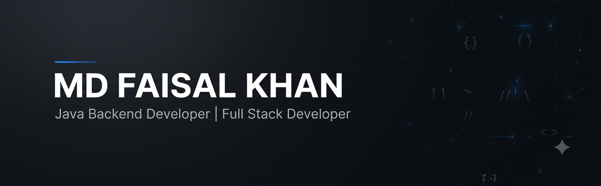

  

# Hi 👋, I'm Md Faisal Khan

  

## 👨‍💻 About Me

Hi, I'm **Md Faisal Khan**, a Computer Science Engineering student at **Teerthanker Mahaveer University (TMU)**, passionate about software development and problem-solving.

- 🎓 Pursuing B.Tech in Computer Science & Engineering (2028)
- ☕ Focused on Java Backend Development and Spring Boot
- ⚛️ Exploring Full Stack Development with React
- 🗄️ Working with SQL, MySQL and REST APIs
- 🧠 Practicing Data Structures & Algorithms
- 🐳 Exploring Docker, Kubernetes and DevOps
- 🚀 Building projects and participating in hackathons
- 🤝 Open to collaboration, learning and new opportunities

My goal is to become a skilled Software Engineer by building practical applications and continuously improving my problem-solving skills.
## 🛠️ Tech Stack

### 💻 Programming Languages

  

### ⚙️ Backend & Frontend

  

### 🗄️ Tools & Technologies

  

### 🚀 Currently Exploring

  

### 🌐 Connect With Me

- GitHub: https://github.com/CodeWithFaisu07
- LinkedIn: Add your LinkedIn profile URL here
- Email: er.faisalkhandev@gmail.com
